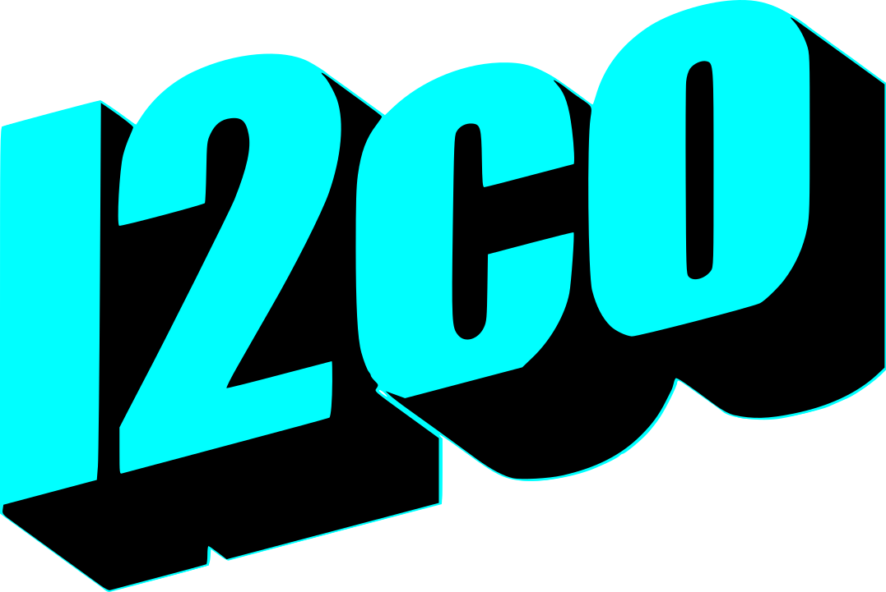
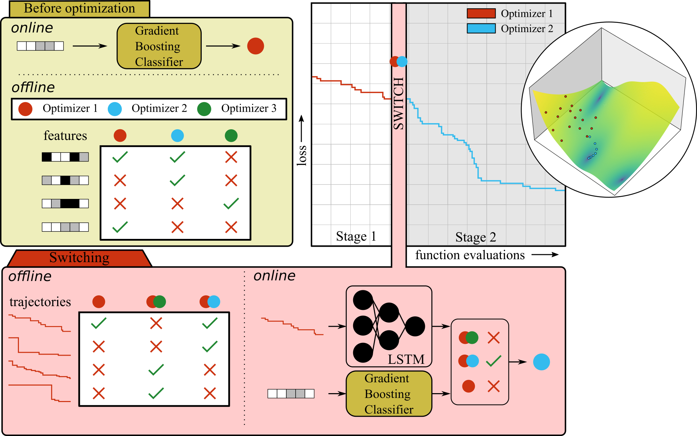

# Learning to Choose Optimizers (l2co)

<div align="center">
  
</div>

[](https://github.com/bessagroup/l2co)


**Docs**
| [**GitHub**](https://github.com/bessagroup/l2co)
| **PyPI**

> Some links are not yet available, as the package is still under a private repository.

***

## Summary

**L2CO** is a Python project accompanying the paper 'Learning to Choose Optimizers'. 

## Statement of need

Optimization plays a central role in Computational Mechanics. However, selecting the right optimization algorithm for a particular task is usually not trivial, as that results from the nature of the optimization problem to be solved and constraints such as available resource budget and training data. In order to address this, there has been a transition from creating hand-designed optimization algorithms to learning how to optimize (L2O), i.e. an approach attempting to learn the optimization conditions themselves. While many studies in the field of L2O have demonstrated good performance on a specific task distribution, they often suffer from poor generalization to other distributions. In addition, established L2O methods are often limited to a specific class of optimization algorithms.

We propose a new approach called "Learning to Choose Optimizers" (L2CO). Our method allows a meta-learner to select at test time from a range of static and well-established optimizers. This enables the system to adapt to different task distributions and enhance generalization performance. The framework is set up to continuously incorporate new optimization algorithms and problems, inviting domain experts to contribute their insights and expertise for ongoing expansion.

In this study, we train our model offline on a diverse set of benchmark loss-functions and apply a range of gradient-based, population-based, and probabilistic model-based optimizers. The potential of this approach is demonstrated by comparing its performance to classical optimizers and established L2O-architectures on benchmark loss-functions and simple material design studies. The results suggest that L2CO can be a useful tool and exhibits better generalization.

<div align="center"></div>

## Authorship

* Current created and developer: [M.P. van der Schelling](https://github.com/mpvanderschelling/) (M.P.vanderSchelling@tudelft.nl)

## Getting started

The package is currently not available on PyPI. To install the package, follow the steps below:

### Installation instructions for users


1. Create a new virtual environment (optional) with Python 3.10+


2. Clone the repository:

```bash
git clone https://github.com/bessagroup/L2CO.git
```

3. Navigate to the repository and install the package using `pip`:

```bash
pip install -e .
```

### Installation instructions for developers

To install the package for development (or for building the mkdocs documentation), install the development dependencies after normal installation:

```bash
pip install -e '.[dev,docs,tests,app]'
```

> For detailed instructions on how to develop on this package, please refer to the [Contributing Guide](CONTRIBUTING.md).

After installation, start by looking at the [Getting Started Guide](./docs/usage.ipynb).

## Experiments

This package includes 3 experiments that demonstrate the capabilities of the package. These studies are available in the `/experiments/` folder:

| Experiment | Description | Status |
| ---------- | ----------- | ------ |
| [`create_optimization_dataset_new`](https://github.com/bessagroup/L2CO/tree/main/experiments/create_optimization_dataset_new) | Creates the training data for the optimization experiments. | Stable |
| [`data_validation`](https://github.com/bessagroup/L2CO/tree/main/experiments/data_validation) | Scripts that validate the optimization data created in `create_optimization_dataset_new`. | Stable |
| [`train_model`](https://github.com/bessagroup/L2CO/tree/main/experiments/train_model) | Trains the L2CO model using the generated dataset. | Stable |

## Community Support

* If you find any **issues, bugs or problems** within this repository, please use the [GitHub issue tracker](https://github.com/bessagroup/l2co/issues) to report them.
* If you have **questions, feature requests or ideas** for this project, please use the [GitHub Discussions](https://github.com/bessagroup/L2CO/discussions)

Please refer to L2CO's [Code of Conduct](CODE_OF_CONDUCT.md)

## License

Copyright 2025, Martin van der Schelling

All rights reserved.

This project is licensed under the BSD 3-Clause License. See [LICENSE](LICENSE) for the full license text.