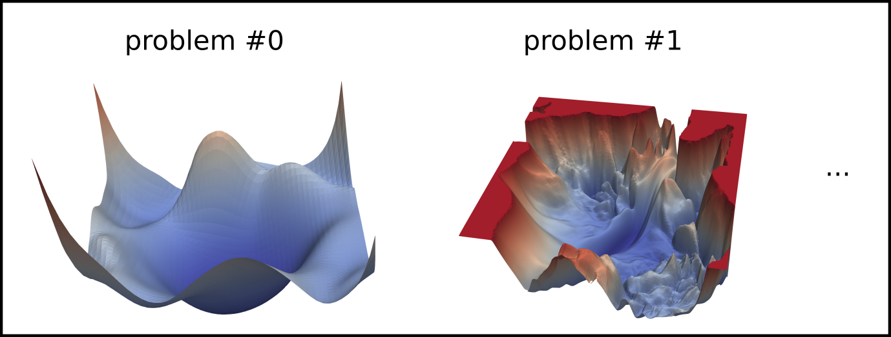
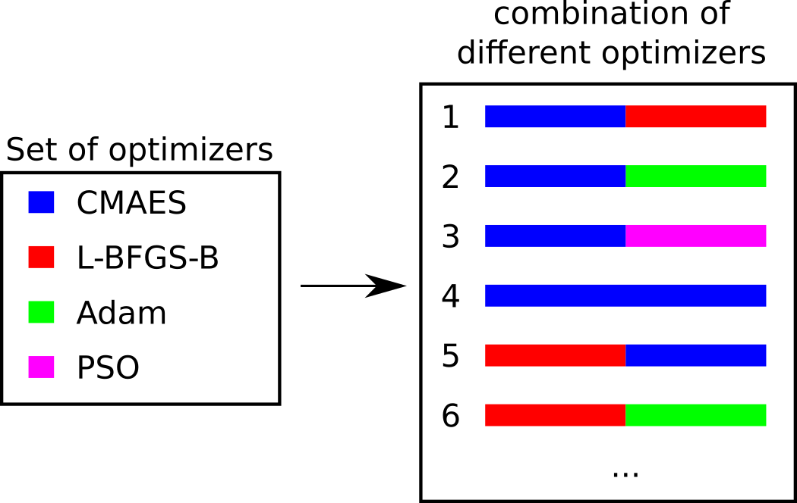
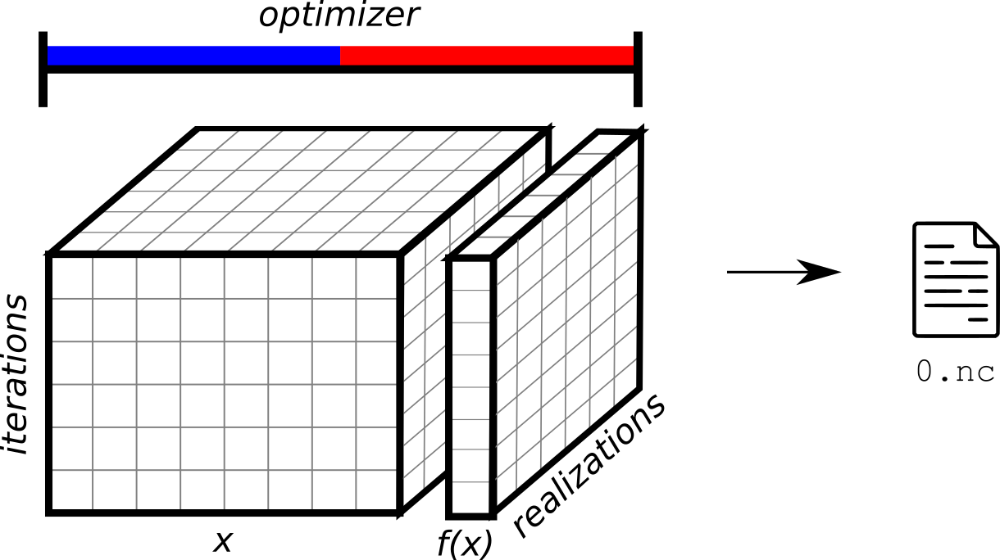
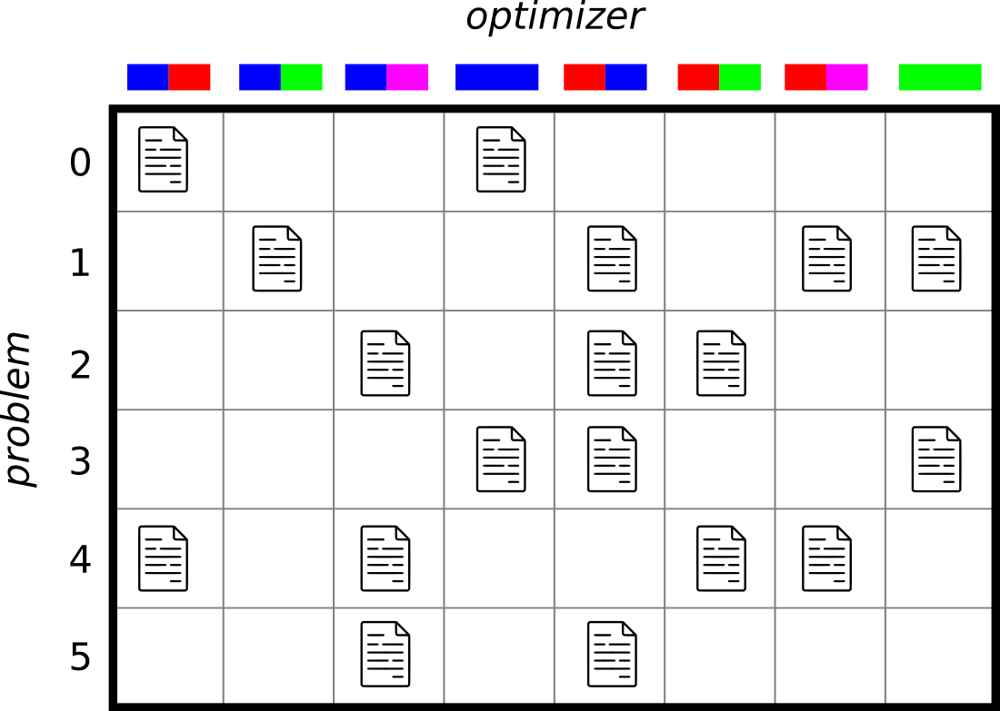

Create trainingdata two optimizers
==================================

Contents of this folder
------------------------

=============== ======================================================
 File/Folder    Description                                        
=============== ======================================================
`main.py`       Main script to run the experiment                   
`config.yaml`   Configuration file for the experiment             
`config.py`     Configuration file type-hints for the experiment    
`README.md`     Explanation of this experiment                      
`img/`          Folder with images used in this file                
`pbsjob.sh`     TORQUE job file to run the experiment in a cluster 
`outputs/`      Folder with the results of running this experiment 
=============== ======================================================

.. note::
    
The `outputs/` folder is created when the experiment has been run for the first time.

Summary
-------

This experiment creates a set of parametrized benchmark functions:

Given a set of optimization algorithms, combinations of two optimizers are created, where we can 'switch' from one optimizer to the other at a given iteration:

The benchmark function is optimized for a given number of iterations and repeated with different initial conditions (realizations). The results are stored in a `NetCDF` (`.nc`) file.

For every optimization problem, we solve the problems with a fraction of the total combination of optimization algorithms (controlled by the parameter `fraction_of_all_combinations`):

Usage
-----

1. Install the l2co package. See `here <https://github.com/bessagroup/L2CO#getting-started>`_ for instructions.
2. Install f3dasm_optimize in your environment. See `here <https://bessagroup.github.io/f3dasm_optimize/rst_doc_files/getting_started.html>`_ for instructions.
3. Navigate to this folder and run `python main.py`.

Results
-------

Results are stored in a newly created `outputs` folder, with a subdirectory indicating the current date (e.g. `2023-11-06`) and time (e.g. `13-50-14`).

The following subdirectories are created:

- `experiment_data`: Contains the input, output, domain, and jobs to construct the `f3dasm.ExperimentData` object.
- `random_samples`: Contains a `NetCDF` (`.nc`) files with random samples for each optimization problem.
- `<opt_1>+<opt2>`: Contains a `NetCDF` (`.nc`) files with the optimization results for each optimization problem. The folder name is the concatenation of the two optimization algorithms used.
- `.hydra`: Contains the `config.yaml` file used to run the experiment.

Lastly, a log file `main.log` is created.

The folder structure is as follows::

    outputs/
    └── 2023-11-06/
        └── 13-50-14/
            ├── .hydra/
            ├── CMAES/
            ├── CMAES+Adam/
            ├── CMAES+PSO/
            │   ├── 0.nc
            │   ├── 1.nc
            │   └── 2.nc
            ├── random_samples/
            │   ├── 0.nc
            │   ├── 1.nc
            │   └── 2.nc
            ├── experiment_data/
            │   ├── domain.pkl
            │   ├── input.csv
            │   ├── output.csv
            │   └── jobs.pkl
            └── main.log
