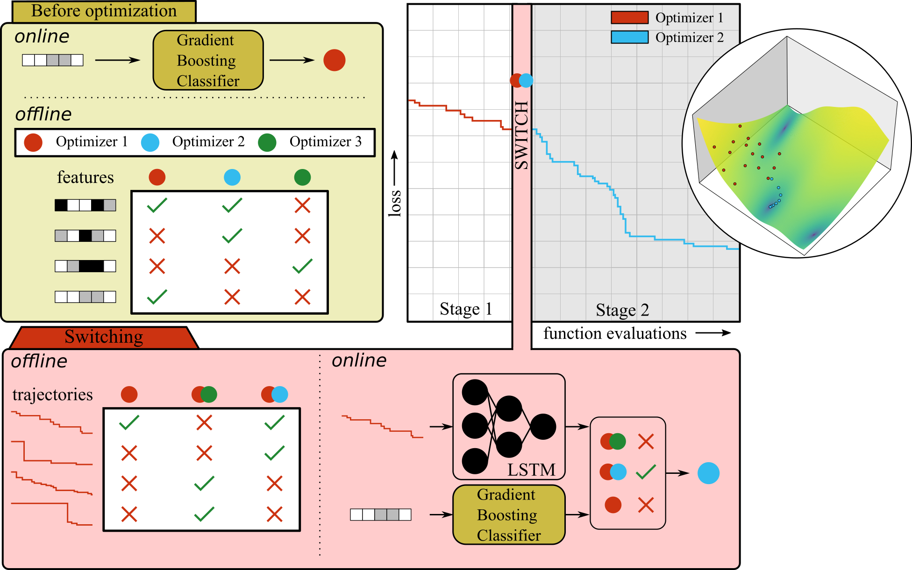

.. _getting_started:

Getting started
========

|

Creating the optimization dynamics dataset: :class:`~l2co.DataLoader`
---------------------------------------------------------------------

Creating the :class:`~l2co.DataLoader` is done in the following steps:

1. Perform an :mod:`f3dasm` experiment
^^^^^^^^^^^^^^^^^^^^^^^^^^^^^^^^^^^^^^

1. Create an :class:`~f3dasm.ExperimentData` object with the problem-dependent and problem-independent features as design space parameters. For clarity now called the 'outer-experimentdata'.
2. Each experiment inside the :class:`~f3dasm.ExperimentData` is an optimization problem itself (from clarity now called the 'inner-experimentdata'), and the objective values at every iteration are stored in the :class:`~f3dasm.ExperimentData` object
3. We export the inner-experimentdata object to a :class:`~xarray.Dataset` object with the :meth:`~f3dasm.ExperimentData.to_xarray` method. You can remove the input parameters from the :class:`~xarray.Dataset` object to save memory.
4. We store the inner-experimentdata :class:`~xarray.Dataset` object with as name the inner-experimentdata optimization algorithm for each outer-experimentdata experiment. We can repeat the inner-experimentdata loop for many optimizers.

This will result in an output-experimentdata (:class:`~f3dasm.ExperimentData`) object with as input space the problem-dependent and problem-independent features and output space NetCDF files of optimization dynamics for various optimizers.

.. code::

    working_dir
    ├── CMAES/
    │   ├── 0.nc
    │   ├── 1.nc
    │   └── 2.nc
    ├── Adam/
    │   ├── 0.nc
    │   ├── 1.nc
    │   └── 2.nc    
    ├── PSO/
    │   ├── 0.nc
    │   ├── 1.nc
    │   └── 2.nc
    ├── experiment_data/
    │   ├── domain.pkl
    │   ├── input.csv
    │   ├── output.csv
    │   └── jobs.pkl
    └── main.log

.. note::

    L2CO requires single-objective optimization problems. If you have multi-objective optimization problems, you can use the :class:`~f3dasm.ExperimentData` object to create a single-objective optimization problem by aggregating the objectives into a single objective using a scalarization function.

2. Validating and post-processing the data
^^^^^^^^^^^^^^^^^^^^^^^^^^^^^^^^^^^^^^^^^^

After you have created the required data structure, you perform the `data_validation <https://github.com/bessagroup/L2CO/tree/main/experiments/data_validation>`_ experiment.
It will validate all the optimization data and create a combined :class:`~xarray.Dataset` object that combines all optimizers and experiments (``entire_dataset.nc``) and all random sample trajectories and experiment (``entire_dataset_samples.nc``).

3. Creating the :class:`~l2co.DataLoader` object
^^^^^^^^^^^^^^^^^^^^^^^^^^^^^^^^^^^^^^^^^^^^^^^^

The :class:`~l2co.DataLoader` hosts all the data from various optimizers on a set of problems. It is used to assess the performance of these optimizers as well as train the L2CO model.
The :class:`~l2co.DataLoader` is created with the following parameters:

- ``data``: :class:`~xarray.Dataset` object (``entire_dataset.nc``) containing the objective values at every iterations of various problems and optimizers
- ``data_samples``: :class:`~xarray.Dataset` (``entire_dataset_samples.nc``) object containing random sampling trajectories of every iterations of various problems, optional
- ``experimentdata``: outer-experimentdata object (:class:`~f3dasm.ExperimentData`) object containing the problem dependent and problem independent features as input parameters.

You can create this object with the :meth:`~l2co.DataLoader.from_preprocessed_files` or :meth:`~l2co.DataLoader.from_saved_files` methods.

.. note::
    
    The package has various plotting functions to visualize the data: :func:`~l2co.plotting.plot_perf_profile` and :func:`~l2co.plotting.plot_rtd_profile`

Creating the L2CO model
-----------------------

Before optimization
^^^^^^^^^^^^^^^^^^^

The first part of the L2CO model is a supervised classification approach where
we train a classifier to predict the optimizer to choose before starting the optimization process.

- The features of the model are the problem dependent and problem independent features from the :class:`~f3dasm.ExperimentData` object.
- THe labels are the :attr:`~l2co.DataLoader.performance` values at the last iteration of the different optimizers on the problem.

A model will be fit for each of the different optimizers. We use the :class:`~sklearn.multioutput.MultiOutputClassifier` from scikit-learn to handle the multi-output classification problem.

Preprocessing of the features
"""""""""""""""""""""""""""""

The preprocessing step is a scikit-learn :class:`~sklearn.compose.ColumnTransformer` that can be used to apply transformations to the input data before training the classifier. 

The preprocessing_step can be created with the :func:`~l2co.preprocessing_factory` function. 
It asks for a dictionary:

- the keys are the problem dependent and problem independent features from the :class:`~f3dasm.ExperimentData` object.
- values are one of the following:

  - ``'ordinal'``: for ordinal features that do have an orderning
  - ``'categorical'``: for categorical features that do not have a specific ranking

Creating the model
""""""""""""""""""

We construct a :class:`~l2co.Stage0Model` with the following parameters:

- ``clf``: The model requires a classifier from scikit-learn that can handle multi-output classification.
- ``preprocessing_step``: A preprocessing step that is applied to the input data before training the classifier.
- ``model_name``: string representing name of the model

During optimization
^^^^^^^^^^^^^^^^^^^

The second part of the model will use the acquired training dynamics to predict which optimizer to choose during the optimization process.

- The features of the model are the normalized objective values from training trajectories of the different optimizers.
- The labels are the same as in the :class:`~l2co.Stage0Model`, but now conditioned on the first choice of each individual model

For each optimizer, a separate model is trained with only optimization trajectories from that optimizer.
Whenever we encounter a testing problem, we consult the trained model of the optimizer that was predicted from the :class:`~l2co.Stage0Model`.

Creating the model
""""""""""""""""""

We construct a :class:`~l2co.Stage1Model` with the following parameters:

- ``optimizer``: :class:`xarray.DataArray` with the names of the optimizers to continue with. A model will be fit for each of the different optimizers.
- ``model``: Trainable model that inherits from :class:`~flax.linen.Module`
- ``t_start``: From where in the optimization process to take the training trajectories
- ``t_switch``: The function evaluation number of the switching preprocessing_step
- ``rel_tolerance``: The relative tolerance for the fixed-target approach to determine which optimizers are succesful
- ``name``: string representing name of the model

.. note::

    At the moment, it is not possible to configure your own hybridization conditions between the :class:`~l2co.Stage0Model` and the :class:`~l2co.Stage1Model`

Combining data and model in the :class:`l2co.Trainer` class
-----------------------------------------------------------

We can combine the :class:`~l2co.DataLoader`, :class:`~l2co.Stage0Model` and :class:`~l2co.Stage1Model` in the :class:`~l2co.Trainer` class. The :class:`~l2co.Trainer` class is responsible for training the models and evaluating the performance of the models.
