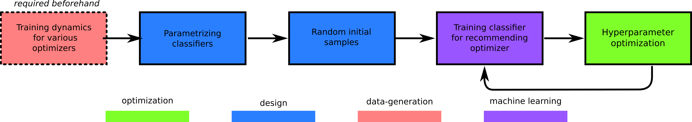
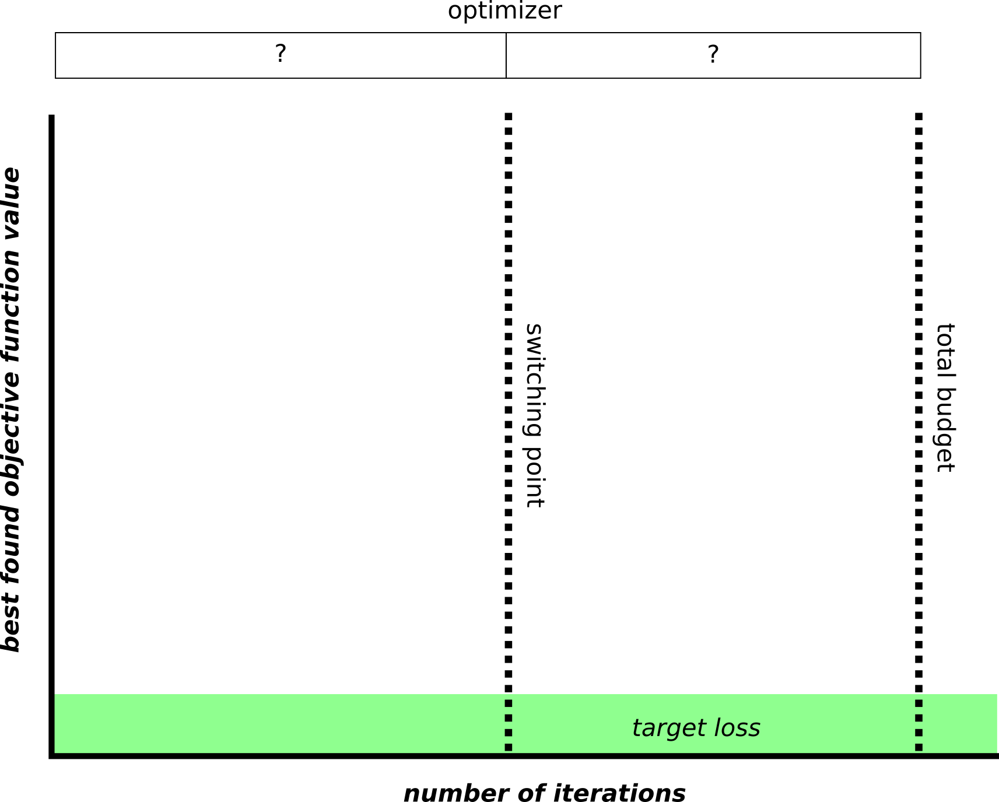

# Investigate stage 0

<center>

</center>

## Summary

After we have [created a training and testing benchmarkfunction set](https://github.com/bessagroup/L2CO/tree/main/experiments/create_trainingdata_two_optimizers), we can investigate the performance of selecting an optimizer whenever we haven't evaluated in the online case yet. We will call this `stage_0` of the recommender system.

<center>

</center>

In this experiment, we evaluate **parametrized classification models** on a **previously acquired dataset of training dynamics**: 

* We will use [available prior knowledge](#problem-specific-characteristics) about the loss-landscape characteristics as features of the classifier.
* The labels will be determined by the optimizer that performans the best on a problem according to a [custom metric](#determining-performance)

This experiment will be as follows:

* Loading the training and testing datasets as `f3dasm.ExperimentData` objects.
* Construct a parametrized classifier and sample instances.
* Train a classifier on the training dataset.
* Evaluate the classifier on the testing dataset and report error metrics.
* Roll-out the classifier on the testing dataset and report the performance of the '`stage_0`'-recommender system with the [performance profile metric](https://www.numerical.rl.ac.uk/people/j_scott/publications/2016/GouldScott.2016_TOMS.pdf)

### Determining performance

To determine the performance of an optimizer on a problem, we will use the following steps to come up with a performance metric:

* The cumulative minimum ('best found solution so far') of the loss function is computed for every optimizer on every problem.
* The cumulative minima are normalized to the median performance of random search on the problem[^1]. 
* We take the log of the normalized cumulative minima.

[^1]: This information is retrieved from the `random_samples` NetCDF file for each problem.

### Problem-specific characteristics

The following problem-specific characteristics are used as features for the classifier:

* Dimensionality (`int`)
* Noise (`bool`)
* Convex (`bool`)
* Separable (`bool`)
* Multimodal (`bool`)

> The author is aware that at the moment these characterstics might not be enough to distinguish a large number of landscapes.


## Contents of this folder

| File/Folder | Description |
|-------------|-------------|
| `main.py` | Main script to run the experiment |
| `config.yaml` | Configuration file for the experiment |
| `README.md` | Explanation of this experiment |
| `img/` | Folder with images used in this file |
| `pbsjob.sh` | TORQUE job file to run the experiment in a cluster |
| `outputs/` | Folder with the results of running this experiment |

> The `outputs/` folder is created when the experiment has been run for the first time.

## Usage

### Before running the experiment

0. Make sure you have two datasets from the [`create_training_data_two_optimizers`](https://github.com/bessagroup/L2CO/tree/main/experiments/create_trainingdata_two_optimizers). The testing dataset should have `fraction_of_all_combinations` set to $1.0$ ! 
1. Install the `l2co` package. See [here](https://github.com/bessagroup/L2CO#getting-started) for instructions.
2. Change the `config.yaml` file to your liking. See [here](#explanation-of-configyaml-parameters) for an explanation of the parameters.

### Running the experiment on your local machine

1. Navigate to this folder and run `python main.py`

### Running the experiment on a TORQUE cluster

1. Make sure you have an `conda` environment named `f3dasm_env` with the packages installed in the first step
2. Navigate to this folder and submit the job with i.e. 2 nodes: `qsub pbsjob.sh -t 0-2`


## Results

Results are stored in a newly created `outputs` folder, with a subdirectory
indicating the current date (e.g. `2023-11-06`).

* When running on a local machine, the output will be saved in a directory indicating the current time (e.g. `13-50-14`).
* When running on a cluster, the output will be saved in a directory indicating the current job ID (e.g. `538734.hpc06.hpc`).

The `experiment_data` subdirectory contains the input, output, domain and jobs to construct the [`f3dasm.ExperimentData`](https://f3dasm.readthedocs.io/en/latest/rst_doc_files/classes/design/experimentdata.html) object.

The `.hydra` subdirectory contains the `config.yaml` file used to run the experiment.

### Saved as references

The following subdirectories are created:

* `performance_profile`: Contains `.csv` files with the first columnname[^2] as the classifier used and the rows the performance profile for each value of $f$.


[^2]: Other columns contain the static optimizers, the best and the worst strategy.

### Saved in `ExperimentData`

The `output` column of the `ExperimentData` object will contain columns for the following classification error metrics:

* `accuracy`
* `precision`
* `recall`
* `f1`
* `confusion matrix`

Lastly, a log file `main.log` is created.

The folder structure is as follows:

```
outputs/
└── 2023-11-06/
    └── 13-50-14/
        ├── .hydra/
        ├── performance_profile/
        │   ├── 0.csv
        │   ├── 1.csv
        │   └── 2.csv
        ├── experiment_data/
        │   ├── domain.pkl
        │   ├── input.csv
        │   ├── output.csv
        │   └── jobs.pkl
        └── main.log
```


## Explanation of `config.yaml` parameters

### Dataset

| Name  | Type   | Description |
|-------|--------|-------------|
| train | `str` | Project directory path to the training dataset |
| test  | `str` | Project directory path to the testing dataset  |

### Domain
#### Classifier model name
| Name       | Type     | Description                |
|------------|----------|----------------------------|
| value | `str`     | Name of classifier (implemented by `l2co`) |

_arbitrary number of hyperparameters for the classifier can be added_


### Experiment Data
#### From Sampling
| Name         | Type   | Description            |
|--------------|--------|------------------------|
| sampler      | `str` | Sampler name            |
| seed         | `int`    | Seed value              |
| n_samples    | `int`    | Number of samples       |
| domain       | `f3dasm.Domain` | `f3dasm` Domain object ([reference](https://f3dasm.readthedocs.io/en/latest/rst_doc_files/classes/design/domain.html))            |


### HPC
| Name   | Type | Description  |
|--------|------|--------------|
| jobid[^3]  | `int`  | Job ID of the array-job, automatically overwritten by scheduler bash script |

[^3]: When running on a local machine, this value will be left as the default: -1.

### Log Level
| Name      | Type | Description     |
|-----------|------|-----------------|
| log_level | `int`  | Log level value ([see `logging` module for more info](https://docs.python.org/3/library/logging.html#logging-levels)) |
