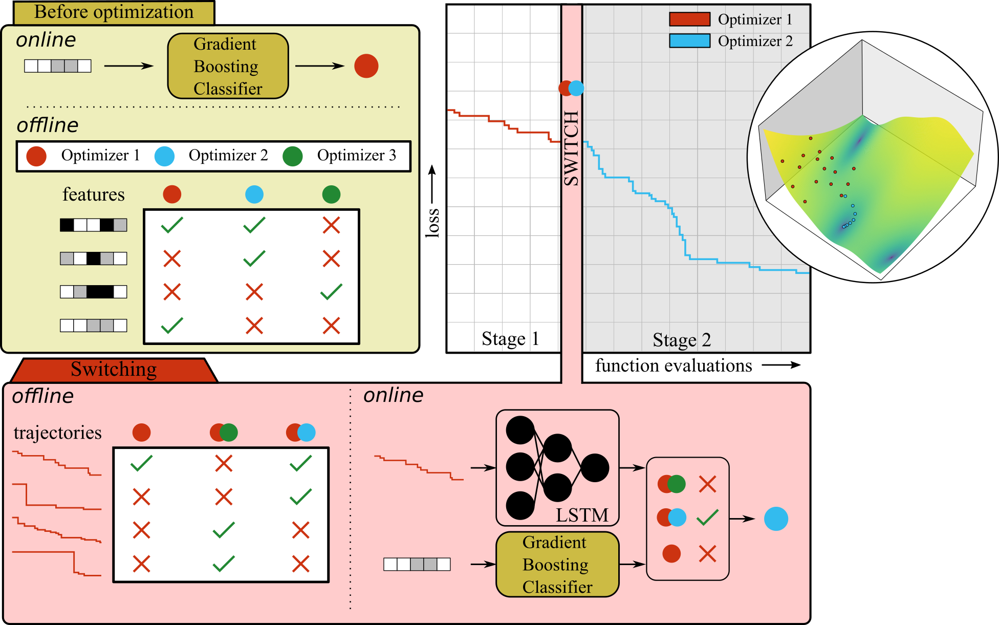

# Recommend optimizer

<center>

</center>

## Contents of this folder

| File/Folder | Description |
|-------------|-------------|
| `main.py` | Main script to run the experiment |
| `recommendoptimizer.py` | Custom `f3dasm.DataGenerator` routing to recommend the optimizer for a testing set |
| `pbsjob.sh` | TORQUE job file to run the experiment on the [TUD Delft HPC](https://hpcwiki.tudelft.nl/index.php?title=Main_Page) cluster |
| `slurmjob.sh` | SLURM job file to run the experiment on the [DelftBlue](https://www.tudelft.nl/dhpc/system) cluster|
| `slurmjob_brown.sh` | SLURM job file to run the experiment on the [OSCAR](https://docs.ccv.brown.edu/oscar) cluster|
| `README.md` | Explanation of this experiment |
| `outputs/` | Folder with the results of running this experiment |
| `img/` | Folder with images used in this file |

> The `outputs/` folder is created when the experiment has been run for the first time.

## Summary

## Usage

### Before running the experiment

1. Install the `l2co` package. See [here](https://github.com/bessagroup/L2CO#getting-started) for instructions.
2. Change the `config.yaml` file to your liking. See [here](#explanation-of-configyaml-parameters) for an explanation of the parameters.

### Running the experiment on your local machine

1. Navigate to this folder and run `python main.py`

### Running the experiment on the TORQUE/DelftBlue/OSCAR cluster

1. Make sure you have an `conda` environment named `f3dasm_env` with the packages installed in the first step
2. Navigate to this folder and submit the job:

| Cluster | Command |
|---------|---------|
| [TUD Delft HPC](https://hpcwiki.tudelft.nl/index.php?title=Main_Page)  | `qsub pbsjob.sh` |
| [DelftBlue](https://www.tudelft.nl/dhpc/system) | `sbatch slurmjob.sh` |
| [OSCAR](https://docs.ccv.brown.edu/oscar) | `sbatch slurmjob_brown.sh` |

You can run this experiment on multiple nodes by submitting an arrayjob (e.g. `qsub -t 0-10 pbsjob.sh` or `sbatch --array=0-10 slurmjob.sh`):
- The first node will (`jobid=0`) handle the creation of the `f3dasm.ExperimentData` object.
- The other nodes will (`jobid=1,2,...`) handle the `f3dasm.DataGenerator` process specified in `recommendoptimizer.py`.

### Performing parameter sweeps

You can do parameter sweeps by changing the `config.yaml` file. For example, you can change the `seed` parameter to a list of seeds to run the experiment with multiple seeds. The same can be done for any (hyper)parameter that is present in the `config.yaml` file.

```yaml
domain:
  stage0_clf.n_estimators:
    type: category
    categories: [10, 50, 100, 200, 500]

  stage0_clf.learning_rate:
    type: category
    categories: [0.1, 0.01, 0.5, 1.0]

  stage0_clf.max_depth:
    type: category
    categories: [3, 6, 10]

  stage0_clf.loss:
    type: category
    categories: ['log_loss', 'exponential']

  rel_tolerance:
    type: category
    categories: [0.0, 0.01, 0.1, 0.2]

  stage1_clf.latent_dim:
    type: category
    categories: [16, 32, 64, 128]
```

> If you want to change nested parameters, you can use the `.` separator ([more information](https://omegaconf.readthedocs.io/en/2.3_branch/usage.html#omegaconf-update)). For example, to change the `learning_rate` of the `stage0_clf` you can use `stage0_clf.learning_rate`.

The ExperimentData object can be created by specifying the amount of samples and the sampling strategy:

```yaml
experimentdata:
  from_sampling:
    sampler: random
    seed: 2023
    n_samples: 5
    domain: ${domain}
```

The parameters of the currently run sample of the `f3dasm.ExperimentData` object will overwrite the parameter in the `config.yaml` file. 


## Results

Results are stored in a newly created `outputs` folder, with a subdirectory
indicating the current date (e.g. `2023-11-06`) and time (e.g. `13-50-14`).

* When running on a local machine, the output will be saved in a directory indicating the current time (e.g. `13-50-14`).
* When running on a cluster, the output will be saved in a directory indicating the current job ID (e.g. `538734.hpc06.hpc`).


The following subdirectories are created:

* `experiment_data`: Contains the input, output, domain and jobs to construct the [`f3dasm.ExperimentData`](https://f3dasm.readthedocs.io/en/latest/rst_doc_files/classes/design/experimentdata.html) object.
* `.hydra`: Contains the `config.yaml` file used to run the experiment.
* `stage0_prediction`: Contains the predictions of the `stage0_clf` for the testing data.
* `stage1_prediction`: Contains the predictions of the `stage1_clf` for the testing data.
* `main.log`: Log file of the experiment.

The folder structure is as follows:

```
outputs/
└── 2023-11-06/
    └── 13-50-14/
        ├── .hydra/
        ├── experiment_data/
        │   ├── domain.pkl
        │   ├── input.csv
        │   ├── output.csv
        │   └── jobs.pkl
        ├── stage0_prediction/
        │   ├── 0.nc
        │   └── 1.nc
        ├── stage1_prediction/
        │   ├── 0.nc
        │   └── 1.nc
        └── main.log
```


## Explanation of `config.yaml` parameters

| Name  | Type | Description  |
|-------|------|--------------|
| seed  | `int`  | Seed for the pseudo-random number generator |
| t_switch  | `int`  | Iteration number of the switching point |
| t_start  | `int`  | Iteration number of the start of the first optimizer |
| iterations | `int` | Number of function evaluations for each optimization run |
| test_size | `int` | Fraction of problems that are reserved for testing |
| rel_tolerance | `float` | Relative tolerance for the targets |
| epochs | `int` | Number of epochs for training the `stage1_clf` |
| batch_size | `int` | Batch size for training the `stage1_clf` |
| optimizer | `optax.GradientTransformation` | Optimizer for training the `stage1_clf` |
| n_optimizers | `int` | Number of optimization algorithms to choose from |

> The `optimizer` key is initialized with the [`instantiate` method of `hydra`](https://hydra.cc/docs/advanced/instantiate_objects/overview/). Therefore the key should be a dictionary with the `_target_` key pointing to a `optax.GradientTransformation` function and the other keys pointing to the arguments of this function (e.g. the `learning_rate`).

### Data

Specifying the directories of the training, testing and ELA data.

| Name   | Type | Description  |
|--------|------|--------------|
| training_project_dir  | `str`  | Path to the `ExperimentData` project directory for the training data |
| test_project_dir | `str`  | Path to the `ExperimentData` project directory for the testing data |
| ela_project_dir | `str`  | Path to the directory for the ELA data |

> If no `test_project_dir` is given, the testing data is created by random splitting from the training data with the `test_size` parameter as the fraction of problems that are reserved for testing.

### Stage0 Model

The `stage0_clf` is a classifier that predicts the best optimizer to start with for a given problem. It should be a scikit-learn classifier that implements the `fit` and `predict` methods.

| Name   | Type | Description  |
|--------|------|--------------|
| stage0_clf | `BaseEstimator` | Stage0 classifier |


> The model is initialized with the [`instantiate` method of `hydra`](https://hydra.cc/docs/advanced/instantiate_objects/overview/). Therefore the `stage0_clf` key should be a dictionary with the `_target_` key pointing to the class name and the other keys pointing to the arguments of the class constructor.

### Stage1 Model

The `stage1_clf` is a classifier that predicts the best optimizer to switch to after a fixed number of function evaluations with for a given problem. It should be a class following the `SingleStage1Model` protocol class. 

| Name   | Type | Description  |
|--------|------|--------------|
| stage1_clf | `l2co.SingleStage1Model` | Stage1 model |

> The model is initialized with the [`instantiate` method of `hydra`](https://hydra.cc/docs/advanced/instantiate_objects/overview/). Therefore the `stage1_clf` key should be a dictionary with the `_target_` key pointing to the class name and the other keys pointing to the arguments of the class constructor.

### Feature types

Specifying the problem-dependent and problem-independent features that are used for training the `stage0_clf` and `stage1_clf`.

| Name   | Type | Description  |
|--------|------|--------------|
| feature_types | `Dict[str, str]` | Dictionary with the feature names as keys and the feature types as values |

Possible values for the feature types are:
- `categorical`: Categorical features (no ordering)
- `ordinal`: Ordinal features (ordering)


### HPC
| Name   | Type | Description  |
|--------|------|--------------|
| jobid  | `int`  | Job ID of the array-job, automatically overwritten by scheduler bash script |

### Log Level
| Name      | Type | Description     |
|-----------|------|-----------------|
| log_level | `int`  | [Log level value](https://docs.python.org/3/library/logging.html#logging-levels) |
